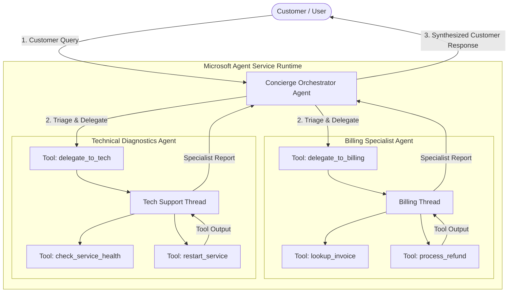

# Microsoft Agent Service — Didactic Architecture & Console Demo

A clean, self-contained educational console application demonstrating the core primitives and multi-agent orchestration pattern of **Microsoft Agent Service** (Azure AI Agent Service / Azure OpenAI Assistants).

> 💡 **Zero External Dependencies**: Runs instantly on standard Python 3. No Azure subscription, API keys, or MCP servers required.

---

## 1. What is Microsoft Agent Service?

Microsoft Agent Service (part of Azure AI Foundry) is an enterprise framework designed for building stateful, autonomous AI agents. Unlike raw LLM chat completions, it provides managed infrastructure for:

1. **Autonomous Agents**: Reusable agents defined by a model, system instructions, and tool definitions.
2. **Persistent Threads**: State and message history reside server-side in threads rather than needing to be resent on every turn.
3. **Runs & Execution Cycles**: Asynchronous state machine (`queued` ➔ `in_progress` ➔ `requires_action` ➔ `completed`).
4. **Tool Calling & Output Feedback**: When an agent decides to invoke an external function or API, it yields a `requires_action` state. The runtime executes the local handler and submits `tool_outputs` back to resume agent execution.

---

## 2. Multi-Agent Architecture in this Demo

This project models the **Supervisor / Orchestrator Pattern** commonly implemented in Microsoft Agent Service and Semantic Kernel:



### The Agents & Their Tools

| Agent | Role | Tools & Capabilities |
| :--- | :--- | :--- |
| **`ConciergeOrchestrator`** | Central triage & coordination | • `delegate_to_billing_agent(sub_query, invoice_id)`<br>• `delegate_to_tech_agent(sub_query, target_service)` |
| **`BillingSpecialistAgent`** | Handles invoicing and payments | • `lookup_invoice(invoice_id)`<br>• `process_refund(invoice_id, amount, reason)` |
| **`TechnicalDiagnosticsAgent`** | Site reliability and cluster health | • `check_service_health(service_name)`<br>• `restart_service(service_name, region)` |

---

## 3. The Microsoft Agent Service Execution Lifecycle

Every agent interaction follows a strict state transition:

```
[QUEUED] ──► [IN_PROGRESS] ──► [REQUIRES_ACTION] ──► [TOOL EXECUTION]
                                     ▲                      │
                                     └── [SUBMIT OUTPUTS] ◄─┘
                                                │
                                                ▼
                                           [COMPLETED]
```

1. **Create Thread & Message**: A thread is created and user text is appended.
2. **Create Run**: Tells the Agent Service to process the thread with an Agent.
3. **`REQUIRES_ACTION`**: The model signals it needs to call one or more tools (e.g. `lookup_invoice`).
4. **Tool Execution**: Client executes the local function and receives the result.
5. **Submit Tool Outputs**: Client submits `ToolOutput` objects back into the run.
6. **`COMPLETED`**: The model synthesizes the final message once all tools have returned results.

---

## 4. How to Run

### Interactive Menu
```bash
python3 run_demo.py
```
Presents a numbered menu to pick scenarios or enter **Interactive Chat Mode** (`[4]`).

### Run by Scenario Number
```bash
python3 run_demo.py 1    # Scenario 1: Billing dispute & refund
python3 run_demo.py 2    # Scenario 2: Technical incident & restart
python3 run_demo.py 3    # Scenario 3: Multi-domain simultaneous delegation
```

### Run Custom Queries Directly
```bash
python3 run_demo.py "Please check if invoice INV-1002 has been paid"
python3 run_demo.py "Check inventory-api status in prod-eu-central-1"
```

### Run All Scenarios Sequentially
```bash
python3 run_demo.py --all
```

---

## 5. Project Structure

```
AgentService/
├── run_demo.py              # CLI entry point (interactive UI + automated scenarios)
├── README.md                # Architectural documentation & concepts
└── agent_service/
    ├── __init__.py          # Exported symbols
    ├── models.py            # Agent, Thread, Run, Tool, Message definitions
    ├── client.py            # Core AgentServiceClient (state machine & lifecycle)
    ├── tools.py             # Domain tools (invoices DB, services DB, handlers)
    ├── simulator.py         # Didactic LLM function calling & reasoning engine
    └── use_case.py          # Orchestrator & Specialist multi-agent wiring
```
